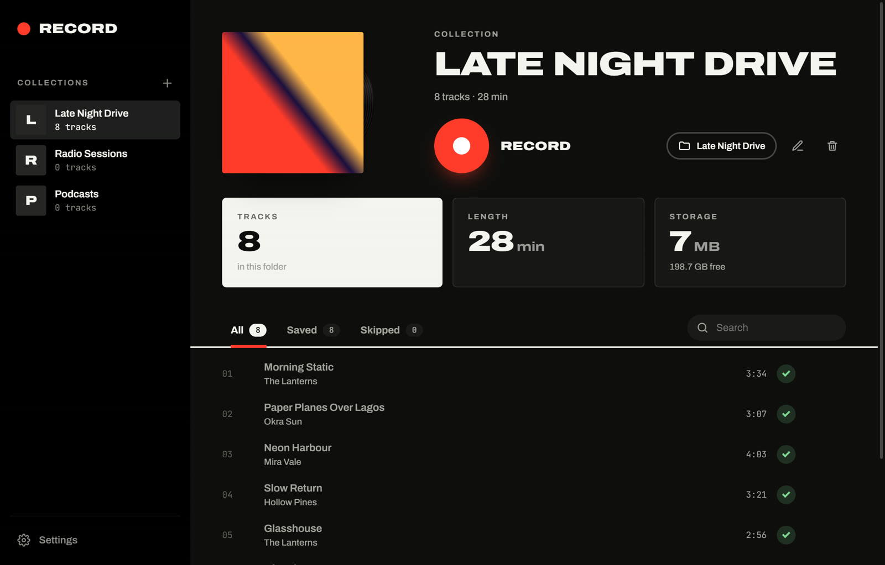

# Record

A Windows desktop app that records what your computer plays and splits it into separate tracks. Each finished track is saved as an MP3 or FLAC file with its title, artist and cover art.

Record works with any player that shows up in the Windows media controls (the box that appears above the volume slider), such as browsers, VLC, foobar2000 and the Media Player app.



## Features

- **Splits tracks on its own.** When the player moves to the next track, Record cuts at the quiet moment between the two.
- **Only keeps complete tracks.** A track you skipped or that was interrupted is thrown away, so you don't end up with half songs.
- **Tags every file** with title, artist, track number and cover art, taken from what the player reports.
- **Collections.** Each collection is a folder. Record into it as often as you like, and tracks you already have are not saved twice.
- **Player controls and a level meter** while recording, plus "stop after this track".
- **Light and dark theme**, following Windows by default.

## Requirements

- Windows 10 or 11
- [Python 3.11](https://www.python.org/downloads/) (tick **Add Python to PATH** during install)
- [ffmpeg](https://ffmpeg.org/), which `setup.bat` installs for you through winget

## Install

```bat
git clone https://github.com/YannKleees/record.git
cd record
setup.bat
```

`setup.bat` creates a virtual environment, installs the packages and ffmpeg, and adds a desktop shortcut. After that, open the app with **`start.bat`** or the shortcut.

## Usage

1. Click **+** to create a collection, or pick a folder you already have.
2. Press the red **Record** button.
3. Play something in any player. Every complete track is saved to the collection's folder.

If several apps play sound, choose the one to follow under **Settings → Listen to**.

### For the best results

- **In your player:** turn off crossfade, automix and volume normalization.
- **In Windows:** turn on Do not disturb. the app records everything your speakers play.

## How it works

1. **Capture.** The app records the system audio through **WASAPI loopback** ([PyAudioWPatch](https://github.com/s0d3s/PyAudioWPatch)).
2. **Follow the player.** Each player reports its title, artist, track length and cover art to Windows ([GlobalSystemMediaTransportControls](https://learn.microsoft.com/uwp/api/windows.media.control)), and the app reads that every 200 ms.
3. **Split.** Audio is held back for 1.5 s. When the title changes, the app cuts at the quietest block in that buffer, which is the gap between the two tracks.
4. **Check.** A track is kept only if the recording is about as long as the player says the track is. When two tracks in a row end a few seconds early, crossfade is probably on, so the app stops and shows a warning.
5. **Save.** ffmpeg trims the silence at both ends and encodes the file. [mutagen](https://mutagen.readthedocs.io/) then writes the tags and cover art.

The interface is plain HTML, CSS and JavaScript in a [pywebview](https://pywebview.flowrl.com/) window. It calls into Python through `pywebview.api`.

```
record/
├── setup.bat              one-time install
├── start.bat              opens the app
├── requirements.txt
├── tests/                 recorder test with a simulated player and sound card
└── record/
    ├── app.py             window, settings and the API the interface calls
    ├── engine.py          recording: now playing, capture, split, encode, tag
    └── ui/                index.html, style.css, app.js, fonts, icon
```

Settings and a log file are stored in `%APPDATA%\Record`.

## Development

```bat
.venv\Scripts\pip install pytest
.venv\Scripts\python -m pytest
```

The test runs the real recorder against a fake player and fake sound card on a simulated clock. It needs no audio hardware and finishes in about two seconds.

## Please record responsibly

Record is a general-purpose audio recorder, like the "record what you hear" feature in Audacity. Only record content you have the right to record, and follow the terms of the services you use.

## License

[MIT](LICENSE). The bundled fonts, Archivo and JetBrains Mono, are under the [SIL Open Font License](record/ui/fonts).
